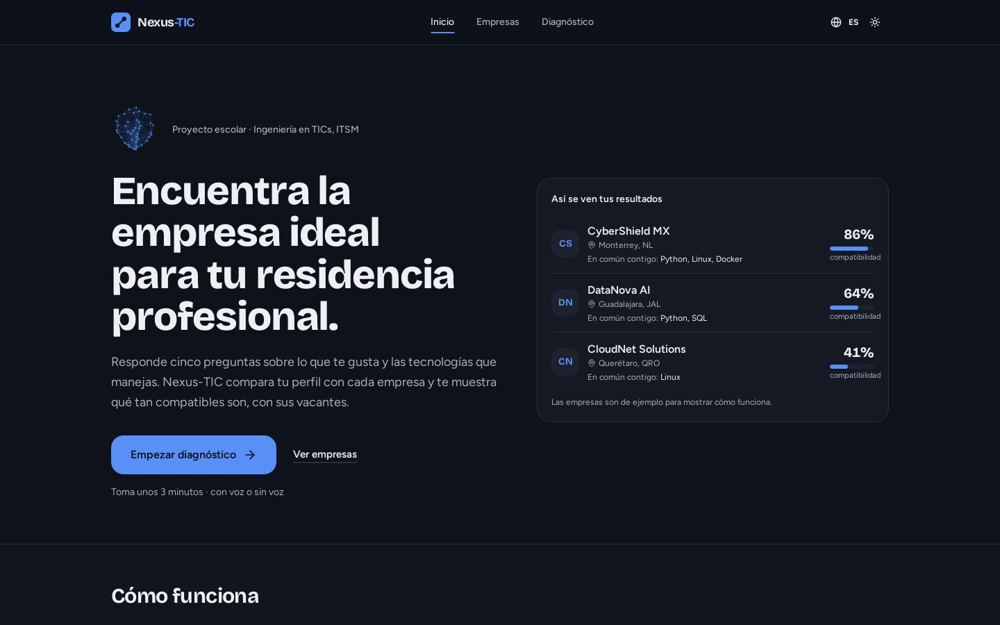
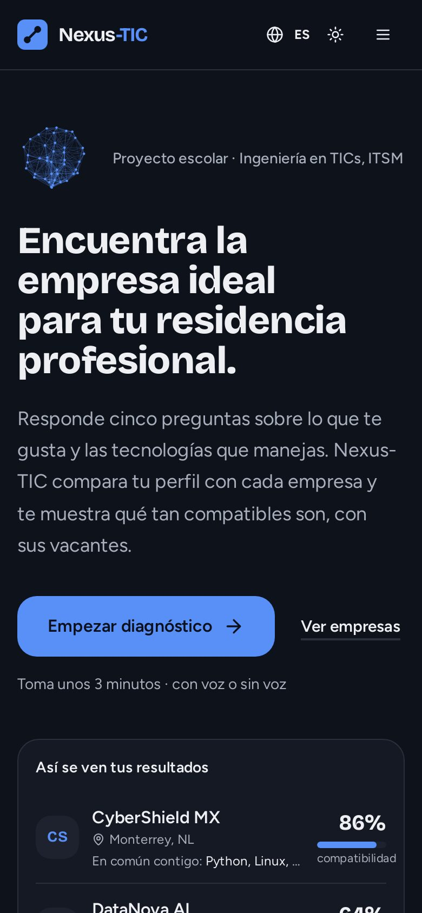
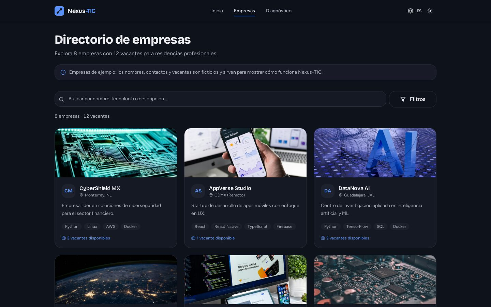

<div align="center">

# Nexus-TIC

**Orientador vocacional para encontrar la residencia profesional ideal en Ingeniería en TICs.**

[**Ver demo**](https://nexus-tic.vercel.app) · Proyecto escolar





</div>

Los estudiantes de TICs suelen elegir dónde hacer sus residencias sin saber qué empresa encaja con su perfil. Nexus-TIC los guía con un **chat de diagnóstico** de cinco preguntas, arma su perfil y les muestra las empresas **ordenadas por compatibilidad**. Funciona con reglas en el navegador; no usa servicios de IA.

## Funciones

- **Chat de diagnóstico** con 5 pasos, barra de progreso e indicador de "escribiendo".
- **Voz opcional:** solo texto (por defecto), voz femenina o masculina, con volumen ajustable y aviso si el navegador no tiene voces en español.
- **Resultados** con porcentaje de compatibilidad, tecnologías en común y ficha en **PDF**.
- **Directorio de empresas** con búsqueda, filtros por tecnología y detalle de vacantes.
- **Español e inglés**, modo claro u oscuro según el sistema, y la animación del cerebro de puntos.
- Empresas marcadas como **de ejemplo** (contactos ficticios con dominios `.example`).
- Análisis de usabilidad documentado en [`docs/analisis-cognitivo.md`](docs/analisis-cognitivo.md): modelos mentales, problemas detectados y soluciones.

## Capturas



<sub>Las empresas y vacantes son datos de ejemplo.</sub>

## Tecnología

**React 18 · TypeScript · Vite · Tailwind CSS · shadcn/ui · Framer Motion · React Router 7 · i18next · Web Speech API · Vercel**

<details>
<summary><b>Cómo correrlo</b></summary>

```bash
git clone https://github.com/ZeroFuann-FS/nexus-tic.git
cd nexus-tic && npm install
npm run dev
```
</details>

---

© 2026 ZeroFuann · Proyecto escolar publicado como portafolio. Ver [LICENSE](LICENSE).
